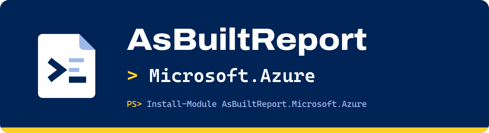

# Repo banner generator

Renders the README banner for every public `AsBuiltReport.*` repo, and the module tiles on the organisation profile, from one HTML template.

| Output | Size | Path |
|---|---|---|
| README banner | 1760 x 480 | `assets/repo-banners/<repo>.png` |
| Profile tile | 840 x 240 | `profile/images/tiles/<repo>.png` |

The [Repo banners](../.github/workflows/repo-banners.yml) workflow runs daily, on pushes to `generator/`, and by hand. It commits only the images that changed. After creating a new repo, run the workflow by hand so its banner exists straight away.

## Banner text

- Line 2 is the repo name without the `AsBuiltReport.` prefix.
- Line 3 is `PS> Install-Module <repo>` when the module is on the PowerShell Gallery, and the GitHub URL when it is not, so a banner never shows a command that fails.
- `repos.json` sets the exceptions: repos to skip, repos without a tile, and fixed line 3 text (the website shows `www.asbuiltreport.com`).

## Using a banner in a README

```html
<p align="center">
    <a href="https://www.asbuiltreport.com/">
        
    </a>
</p>
```

New modules get this from the [Plaster template](https://github.com/AsBuiltReport/AsBuiltReport.Plaster.Template).

## Running it locally

Needs Node.js 22 or later.

```sh
cd generator
npm ci
npx playwright install chromium
node render.mjs                                      # every repo
node render.mjs --repo AsBuiltReport.Microsoft.Azure # one repo
```

To preview a layout change, open `template.html` in a browser with a query string, for example `template.html?kind=banner&name=Microsoft.Azure`. Local renders on Windows or macOS differ slightly from the Linux runner, so let the workflow produce the committed images.

## Fonts

Archivo and Cascadia Code are copied from the project website and used under the SIL Open Font License (see `fonts/`).
